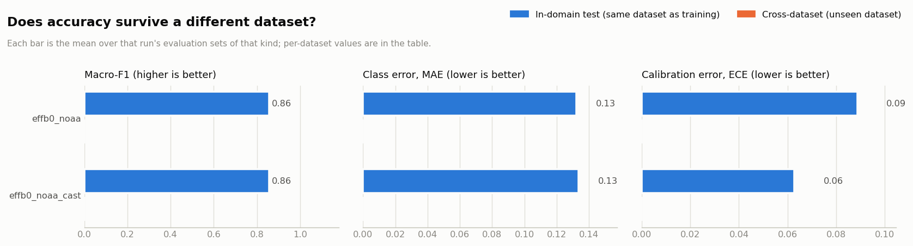
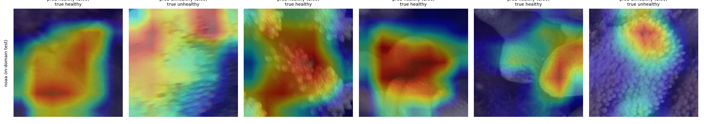
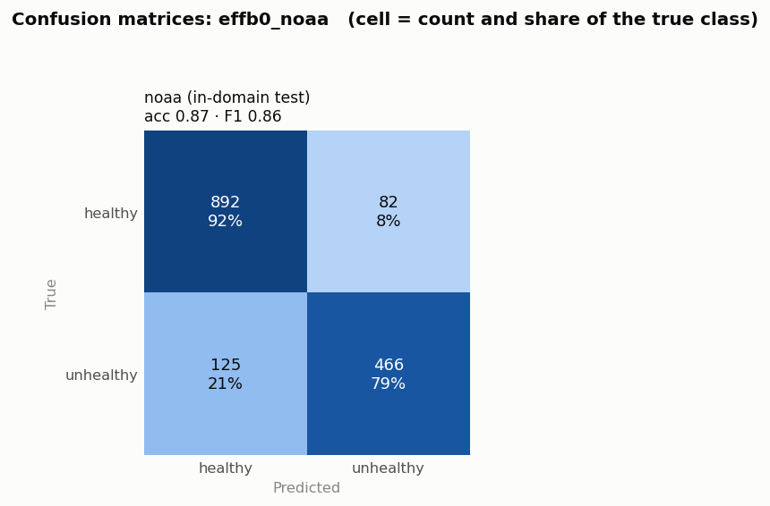
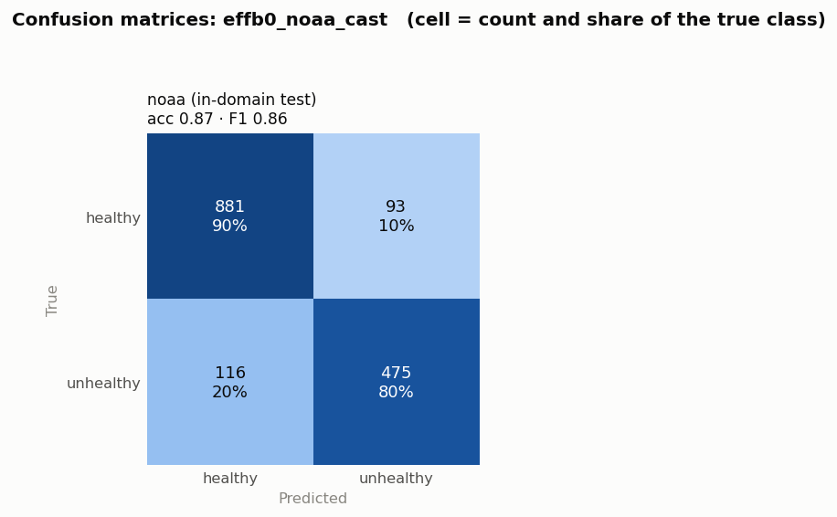

# 🪸 Coral Bleaching Robustness: Cross-Dataset Generalization & Colour-Shortcut Analysis

[](https://www.python.org/)
[](https://pytorch.org/)
[](https://gradio.app/)
[](LICENSE)
[](https://huggingface.co/datasets/De129472/NOAA-PIFSC-ESD-CORAL-Bleaching-Dataset)

> **Core Research Question:** *Bleaching classifiers typically report 95%+ accuracy when trained and evaluated on a single reef dataset. Does that accuracy survive on a different reef, and is the neural network examining coral morphology or just exploiting water colour shortcuts?*

---

## 📌 Table of Contents
- [Executive Summary](#-executive-summary)
- [Benchmark Results](#-benchmark-results)
- [Methodology & Diagnostic Probes](#-methodology--diagnostic-probes)
- [Live Interactive Web App](#-live-interactive-web-app)
- [Automated Kaggle GPU Training](#-automated-kaggle-gpu-training)
- [Quick Start](#-quick-start)
- [Datasets](#-datasets)
- [CLI Reference](#-cli-reference)
- [Project Architecture](#-project-architecture)
- [Key Takeaways & Caveats](#-key-takeaways--caveats)

---

## 🔬 Executive Summary

Automated computer vision systems for marine conservation often suffer from undetected domain shifts caused by varying water depths, turbidity, salinity, lighting conditions, and camera hardware. 

This project benchmarks deep convolutional networks (EfficientNet-B0, ResNet50, ConvNeXt) on coral health classification and introduces:
1. **Shortcut Probes**: Stress-testing models using grayscale conversion (removing colour) and patch-shuffling (destroying spatial morphology while preserving colour statistics).
2. **Colour-Only Baselines**: Logistic regression trained purely on RGB color histograms to measure how much of the task is solvable without any spatial understanding.
3. **Underwater Colour-Cast Augmentation**: A physics-inspired underwater tint and haze augmentation that substantially improves confidence calibration.
4. **Grad-CAM Attention Mapping**: Visual interpretability showing whether activations center on coral polyps or water background.

---

## 📊 Benchmark Results

Evaluated on **1,565 held-out test patches** from the **NOAA PIFSC ESD Hawaii Coral Bleaching Dataset**:

| Model Architecture / Run | Training Setting | Test Accuracy | Macro-F1 | MAE | ECE (Calibration) ↓ | Colour-Only F1 | Grayscale F1 | Patch-Shuffle F1 |
|:---|:---|:---:|:---:|:---:|:---:|:---:|:---:|:---:|
| **`effb0_noaa`** | Baseline (Standard) | **86.8%** | **0.857** | 0.132 | 0.089 | 0.799 | 0.766 | 0.790 |
| **`effb0_noaa_cast`** | Underwater Colour-Cast Aug | **86.6%** | **0.857** | 0.134 | **0.063** *(+29% better)* | 0.799 | 0.743 | 0.763 |

### Key Scientific Insights:
- **Colour Shortcuts are Prevalent:** A trivial logistic regression baseline seeing *only 16-bin colour histograms* achieves **~0.799 Macro-F1**, indicating that water tint and colour distribution provide massive shortcut cues.
- **Morphology vs. Colour Reliance:** Under 4×4 patch-shuffling (which shuffles spatial layout but retains color statistics), accuracy only drops by ~0.06 F1, demonstrating that classifiers rely heavily on global colour distribution rather than fine coral texture.
- **Improved Calibration with Cast Augmentation:** Incorporating simulated underwater blue/green tint and turbidity shifts improves Expected Calibration Error (ECE) from **0.089 to 0.063**, making the model significantly more reliable for field deployment.

### Visual Diagnostics
| Overview Benchmark Chart | Grad-CAM Attention Heatmaps |
|:---:|:---:|
|  |  |

| Confusion Matrix (Baseline) | Confusion Matrix (Colour-Cast Aug) |
|:---:|:---:|
|  |  |

---

## 🛠 Methodology & Diagnostic Probes

### 1. Underwater Colour-Cast Augmentation (`augment.py`)
Simulates varying optical depth and turbidity during training:
- **Spectral Gain Shift:** Random gain scaling per channel: $R \in [0.6, 1.0]$, $G \in [0.8, 1.1]$, $B \in [0.9, 1.2]$.
- **Veiling Light / Haze:** Blends random underwater haze vectors with attenuation factor $t \in [0.0, 0.35]$.
- **Dynamic Exposure:** Scales image brightness by factor $[0.7, 1.2]$.

### 2. Diagnostic Probes (`analyze.py`)
- **Colour Baseline:** Evaluates logistic regression on channel histograms and summary statistics.
- **Grayscale Probe:** Converts test images to grayscale. A large accuracy drop indicates heavy reliance on hue.
- **Patch-Shuffle Probe:** Divides images into an $N \times N$ grid (default 4×4) and randomly permutes the tiles. Survival under shuffle indicates reliance on statistical colour rather than anatomical shape.
- **Grad-CAM:** Generates activation heatmaps blended over coral structures.

---

## 💻 Live Interactive Web App

An interactive Gradio application is included for live inference, Grad-CAM inspection, and dashboard exploration:

```bash
python app.py --runs runs
```
Open **`http://127.0.0.1:7860`** in your browser.

- **Tab 1: Live Detection**:
  - Test live webcam feed or upload coral photos.
  - View real-time predictions, confidence badges, and Grad-CAM overlays.
  - Stress-test the input live against Grayscale and Patch-Shuffle probes.
- **Tab 2: Results Dashboard**:
  - Comprehensive comparison tables and interactive confusion matrices.

*(Pre-trained weights `effb0_noaa` and `effb0_noaa_cast` are included in `runs/` so the app runs out-of-the-box!)*

---

## ☁️ Automated Kaggle GPU Training

A 100% automated Jupyter Notebook is provided in [`coral_bleaching_kaggle.ipynb`](coral_bleaching_kaggle.ipynb):
1. Create a new notebook on [Kaggle](https://www.kaggle.com).
2. Go to **File** → **Upload Notebook** → select `coral_bleaching_kaggle.ipynb`.
3. Set **Accelerator**: **GPU T4** and **Internet**: **ON**.
4. Click **Run All**.

The notebook automatically downloads the NOAA Hawaii dataset (10,419 images), trains baseline and colour-cast models, executes all shortcut probes, generates the HTML report, and outputs a downloadable `coral_bleaching_results.zip`.

---

## 🚀 Quick Start

### Installation
```bash
git clone https://github.com/24F1001211/coral-bleaching-robustness.git
cd coral-bleaching-robustness
pip install -r requirements.txt
```

### Smoke Test (Verify Pipeline in 10 Seconds)
```bash
# 1. Generate synthetic smoke-test data
python make_dummy_data.py data

# 2. Train test run
python train.py --data-root data --source dsA --targets dsB --arch resnet18 --epochs 1 --bs 8 --workers 0 --out runs/smoke

# 3. Run probes and Grad-CAM
python analyze.py --run runs/smoke --task colour
python analyze.py --run runs/smoke --task probes --workers 0
python analyze.py --run runs/smoke --task gradcam

# 4. Generate report
python report.py --runs runs --out report
```

---

## 📁 Datasets

Download real marine biology datasets with a single command:
```bash
# NOAA Hawaii (10,419 patches) & Coralscapes Red Sea
python download_datasets.py noaa coralscapes
```

| Dataset Name | Source | Description | Classes |
|:---|:---|:---|:---|
| **`noaa`** | Hugging Face [`De129472/NOAA-PIFSC-ESD-CORAL-Bleaching-Dataset`](https://huggingface.co/datasets/De129472/NOAA-PIFSC-ESD-CORAL-Bleaching-Dataset) | 10,419 close-up patches (224×224) from Hawaii (2014–2019). | Healthy (`coral`), Bleached (`coral_bl`) |
| **`coralscapes`** | Hugging Face [`EPFL-ECEO/coralscapes`](https://huggingface.co/datasets/EPFL-ECEO/coralscapes) (arXiv 2503.20000) | 2,075 Red Sea reef photos with expert segmentation masks. Sliced into 256px patches with derived labels. | Healthy, Bleached, Dead |
| **`roboflow_reef`** | Roboflow Universe | Coral reef photos with 3-class annotations. *(Requires free API key)* | Healthy, Bleached, Dead |

---

## 📖 CLI Reference

### 1. Training Baseline & Robustness Models
```bash
# In-domain baseline (EfficientNet-B0)
python train.py --data-root data --source noaa --scheme binary --arch efficientnet_b0 --epochs 15 --bs 64 --out runs/effb0_noaa

# Cross-dataset generalization (Train on NOAA -> Test on Coralscapes)
python train.py --data-root data --source noaa --targets coralscapes_patch --scheme binary --arch efficientnet_b0 --out runs/effb0_cross

# Underwater colour-cast augmentation
python train.py --data-root data --source noaa --scheme binary --cast --arch efficientnet_b0 --epochs 15 --bs 64 --out runs/effb0_noaa_cast

# Architecture comparison (ResNet-50 or ConvNeXt-Tiny)
python train.py --data-root data --source noaa --scheme binary --arch resnet50 --out runs/resnet50_noaa
python train.py --data-root data --source noaa --scheme binary --arch convnext_tiny --out runs/convnext_noaa
```

### 2. Shortcut & Interpretability Analysis
```bash
python analyze.py --run runs/effb0_noaa --task colour
python analyze.py --run runs/effb0_noaa --task probes
python analyze.py --run runs/effb0_noaa --task gradcam
```

### 3. Generate HTML Report
```bash
python report.py --runs runs --out report
# Open report/index.html to view all figures and metrics tables
```

---

## 📂 Project Architecture

```
coral-bleaching-robustness/
├── analyze.py                 # Shortcut probes (colour baseline, grayscale, patch shuffle, Grad-CAM)
├── app.py                     # Interactive Gradio web application & live demo
├── augment.py                 # Underwater colour-cast augmentation & stress-test transforms
├── coral_bleaching_kaggle.ipynb # Self-contained Kaggle GPU training notebook
├── data.py                    # Dataset loading, folder alias mapping, grouping & splitting
├── download_datasets.py       # Automated Hugging Face & Roboflow dataset downloader
├── infer.py                   # Single-image inference, Grad-CAM blend, and probe evaluation
├── make_dummy_data.py         # Synthetic dataset generator for pipeline smoke-testing
├── metrics.py                 # Accuracy, Macro-F1, Ordinal MAE, and Calibration Error (ECE)
├── models.py                  # Model backbones (EfficientNet, ResNet, ConvNeXt) & loss heads
├── report.py                  # HTML report & visualization compiler
├── requirements.txt           # Python dependencies
├── viz.py                     # Matplotlib visualization styles & comparison figures
├── report/                    # Generated charts, confusion matrices, and index.html
└── runs/                      # Model checkpoints (.pt), items.json, and results.json
```

---

## ⚠️ Key Takeaways & Caveats

1. **Beware Single-Dataset Benchmarks:** High in-domain accuracy (>90%) in underwater vision does not guarantee real-world generalization; classifiers often latch onto regional water tint.
2. **Calibration Matters:** In conservation field work, confidence estimation is crucial. Augmentation strategies that address water attenuation significantly improve calibration (ECE) without sacrificing macro-F1.
3. **Interpretability is Essential:** Grad-CAM overlays should always be reviewed to ensure activations isolate coral tissue rather than background sand or open water.

---

## 📜 Citation & Acknowledgements
- **NOAA PIFSC ESD**: NOAA Pacific Islands Fisheries Science Center, Ecosystem Sciences Division.
- **EPFL-ECEO Coralscapes**: *Coralscapes: A Large-Scale Dataset for Coral Reef Segmentation* (arXiv 2503.20000).
